# 02 — Luồng dữ liệu từ nguồn đến dashboard

```mermaid
flowchart LR
    A[Giá SJC và dữ liệu thị trường] --> B[Kiểm tra và chuẩn hóa]
    B --> C[Ghép theo thời điểm khả dụng]
    C --> D[Đặc trưng quá khứ và nhãn tháng lịch]
    D --> E[Huấn luyện theo thời gian]
    E --> F[Dự báo điểm và hiệu chỉnh P/Q10]
    F --> G[Kiểm định và nhật ký dự báo]
    G --> H[CSV snapshot và JSON dashboard]
    H --> I[Giao diện web]
```

| Bước | Giải thích khi trình bày | Mở mã |
|---|---|---|
| Thu thập | Giá SJC, vàng thế giới, tỷ giá và các nguồn vĩ mô/tin tức có thời điểm nguồn | [scripts/collection](../../scripts/collection/) |
| Kiểm tra nguồn | Lịch sử dùng record có requested_date bằng business_date và giá mua/bán hợp lệ; nguồn chỉ có giá hiện tại không được giả làm lịch sử | [reliability.py](../../src/gold_collectors/reliability.py) |
| Ghép dữ liệu | Chỉ dùng thông tin đã khả dụng tại ngày dự báo; dữ liệu vĩ mô theo available_from | [07 — Model frame có chú thích](code/07_build_model_frame.py) |
| Nhãn | Mua ở giá bán hôm nay, thoát ở giá mua phiên hợp lệ đầu tiên từ ngày tròn tháng | [01 — Targets có chú thích](code/01_targets.py) |
| Đặc trưng | Chênh lệch mua–bán, động lượng, biến động, vàng thế giới, tỷ giá, premium và mùa vụ | [02 — Features có chú thích](code/02_stationary_features.py) |
| Huấn luyện | Mỗi fold chỉ học các nhãn đã đáo hạn trước thời điểm dự báo | [03 — Nghiên cứu mô hình](code/03_stationary_research.py) |
| Kiểm định | Tách dữ liệu phát triển khỏi dự báo mới; chờ đáo hạn và so với đối chứng | [04 — Kiểm định có chú thích](code/04_snapshot_validation.py) |
| Công bố | Dùng cùng dự báo cho CSV, sổ mô phỏng và web; kiểm tra cùng ngày snapshot | [06 — Snapshot có chú thích](code/06_active_snapshot.py) |

## Công thức cần giải thích

`net_return_h = giá_mua_SJC_tại_phiên_thoát / giá_bán_SJC_ngày_mua - 1`

Ví dụ: nhà đầu tư trả **100 triệu đồng/lượng** để mua; sau 3 tháng cửa hàng mua lại với giá **103 triệu**. Lợi suất là `103 / 100 - 1 = 0,03`, tức **3%**. Nếu cửa hàng chỉ mua lại 99 triệu thì lỗ 1%. Công thức phản ánh chênh lệch giá mua–bán; chưa mô hình hóa mọi chi phí riêng như lưu giữ, vốn vay hoặc trượt giá thực hiện.

1/3/5 là **tháng lịch**, tính bằng DateOffset; 21/63/126 trong tên đặc trưng là số dòng quan sát quá khứ. Các báo cáo cũ dùng định nghĩa ngày quan sát cần đọc đúng phiên bản.

Tin tức có thể hiển thị làm bối cảnh trên dashboard, nhưng không đồng nghĩa mọi tiêu đề đều được dùng huấn luyện. Thông tin thu thập hồi cứu thiếu bằng chứng khả dụng đúng thời điểm phải bị loại khỏi phép đánh giá lịch sử.
