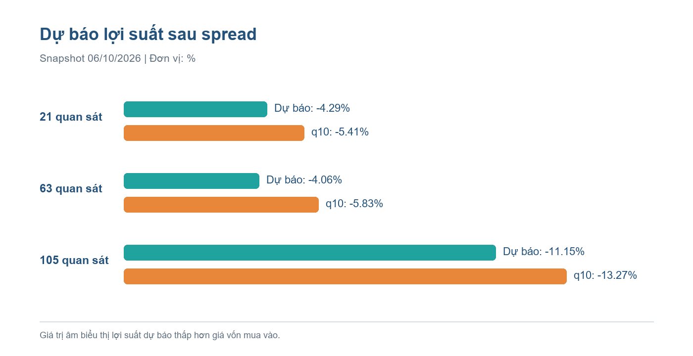
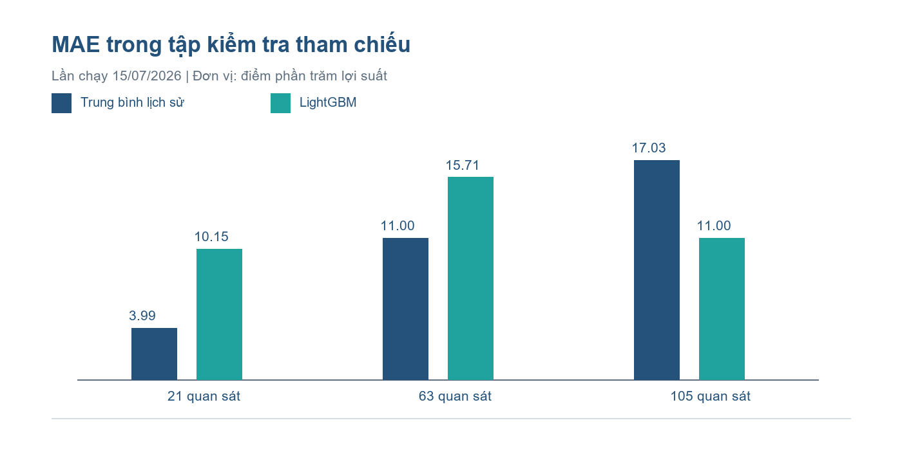
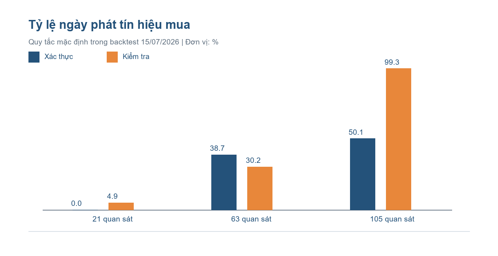

# REPORT 3: MODEL & RESULTS

> **Lưu ý phiên bản:** Đây là báo cáo lịch sử về kỳ hạn 21/63/105 quan sát và snapshot cũ. Phiên dự báo hiện hành đã đổi sang 1/3/5 tháng lịch; xem `data/lake/modeling/snapshot_forecasts.csv` và notebook mới để lấy kết quả hiện tại.

> **Snapshot 20/10/2026 sau cập nhật sự kiện:** dự báo lợi suất ròng 1/3/5 tháng lần lượt là **−3,61% / +11,23% / +12,92%**; tín hiệu mua chỉ bật ở kỳ hạn 3 tháng. Dữ liệu GPR chính thức đến 19/10/2026 và tin RSS đến 21/10/2026; tin ngày 21/10 không nằm trong khung model kết thúc ngày 20/10. Các kết quả backtest bên dưới vẫn thuộc cấu hình lịch sử.

## Phát triển và đánh giá mô hình hỗ trợ quyết định mua vàng SJC tại Việt Nam

**Loại tài liệu:** Báo cáo nghiên cứu thực nghiệm  
**Ngày lập báo cáo:** 13/10/2026  
**Snapshot mới nhất:** dữ liệu đến 06/10/2026; dự báo tạo ngày 13/10/2026  
**Lần chạy backtest tham chiếu:** 15/07/2026; dữ liệu đánh giá kết thúc ngày 11/07/2026  
**Từ khóa:** vàng SJC, dự báo lợi suất, walk-forward, SARIMAX, LightGBM, tín hiệu mua

### Tóm tắt

Nghiên cứu trình bày dự báo mới nhất của hệ thống hỗ trợ quyết định mua vàng SJC tại snapshot 06/10/2026 và đặt kết quả vào bối cảnh backtest đã lưu. Khung dữ liệu mới có 5.558 ngày từ 06/07/2011 đến 06/10/2026. Random Forest dự báo lợi suất sau spread lần lượt -4,29%, -4,06% và -11,15% cho 21, 63 và 105 quan sát tiếp theo; ước lượng phân vị q10 đều âm và cả ba quy tắc mua đều tắt. Đây là **dự báo chưa có nhãn tương lai để kiểm chứng**. Lần chạy backtest tham chiếu ngày 15/07/2026 dùng 5.485 ngày đến 11/07/2026; baseline vẫn rất cạnh tranh ở 21/63 ngày, còn LightGBM đạt MAE 0,1100 ở 105 ngày trên pha kiểm tra. Kết luận của nghiên cứu là chưa có cơ sở phát tín hiệu mua ở snapshot hiện tại; đồng thời, chưa thể xem backtest cũ là thẩm định trực tiếp cho Random Forest snapshot mới. Khác biệt phiên bản, premium tại ngày snapshot bị thiếu và nguy cơ rò rỉ nhãn cần được xử lý trước khi sử dụng hệ thống cho quyết định đầu tư.

## 1. Giới thiệu và câu hỏi nghiên cứu

Giá bán vàng SJC trong nước phụ thuộc vào giá vàng quốc tế, tỷ giá, chênh lệch nội địa và các cú sốc chính sách. Với nhà đầu tư mua vàng vật chất, biến mục tiêu có ý nghĩa hơn biến động giá niêm yết là lợi suất thu được khi **mua ở giá bán tại thời điểm t và bán lại ở giá mua tại t+h**. Nghiên cứu đặt ra ba câu hỏi: (1) mô hình có giảm sai số ngoài mẫu so với đối chứng đơn giản hay không; (2) độ chính xác có ổn định giữa 21, 63 và 105 ngày và giữa xác thực/kiểm tra hay không; (3) dự báo có tạo được quy tắc mua mang tính sàng lọc và hiệu quả sau spread hay không.

Phạm vi của Report 3 là snapshot mới nhất trong `data/lake/modeling/model_frame_daily.csv` và `snapshot_forecasts.csv`, đối chiếu với lần chạy walk-forward lưu trong `analysis_summary.json`, `model_results.csv`, `walk_forward_predictions.csv` và `decision_signals.csv` ngày 15/07/2026. Hai nhóm artifact có thời điểm khác nhau; số liệu backtest cũ chỉ dùng làm tham chiếu lịch sử, không được trình bày như đánh giá ngoài mẫu cho mô hình snapshot mới.

## 2. Model Development

### 2.1. Biến mục tiêu và dữ liệu đầu vào

Với h thuộc {21, 63, 105}, lợi suất ròng mục tiêu là `net_return_h(t) = buy_price(t+h) / sell_price(t) - 1`. `sell_price(t)` là mức người mua trả ban đầu; `buy_price(t+h)` là mức đại lý trả khi bán lại. Công thức phản ánh spread niêm yết, nhưng chưa bao gồm phí lưu giữ, thuế, trượt giá, chi phí vốn hoặc ràng buộc giao dịch. Các nhãn không thiếu lần lượt là 5.464, 5.422 và 5.380 quan sát. Chân trời được tính bằng **số dòng/quan sát**, không phải số ngày lịch tuyệt đối; bảng nguồn có cả ngày cuối tuần, nên cách gọi “ngày giao dịch” cần được kiểm toán trước khi diễn giải kinh tế.

Nguồn mục tiêu là lịch sử báo giá SJC; các biến giải thích gồm giá mua/bán, spread, vàng quốc tế quy đổi VND, premium, USD/VND, VIX, DXY, lãi suất trái phiếu Mỹ, GPR, biến cố thị trường và tin tức tiếng Việt. Dữ liệu vĩ mô Việt Nam dùng `available_from` để giới hạn thời điểm có thể biết; chuỗi quốc tế và GPR được ghép theo thông tin không muộn hơn ngày trước quyết định. Các đặc trưng trễ 1, 5, 10, 21, 63 và 105 quan sát và trung bình/độ lệch chuẩn cuộn được tạo từ chuỗi quá khứ. Giá trị khuyết của đặc trưng dùng trung vị **chỉ từ tập huấn luyện** của từng fold.

Chỉ số `premium_missing_rate = 0` trong bản tổng hợp nghĩa là không còn ô thiếu trong khung mô hình sau xử lý, **không chứng minh benchmark gốc đầy đủ hoặc premium đáng tin cậy**. Bản kiểm toán độ nhạy ghi nhận nhóm premium chất lượng cao chỉ 3.769/5.485 dòng. Lãi suất tiền gửi Việt Nam không có giá trị lịch sử dùng được và bị loại khỏi đặc trưng; do đó chưa tính được lợi suất vượt kênh tiết kiệm. Dữ liệu tin tức hồi cứu dùng ngày bài viết và độ trễ một ngày, nhưng thời điểm tin thực sự khả dụng tại quá khứ chưa được chứng minh; tỷ lệ ngày có headline chỉ khoảng 12,8%.

Ở **khung dữ liệu mới nhất**, có 5.558 dòng và 73 giá trị `premium` bị thiếu; riêng ngày 06/10/2026, `premium` và `premium_pct` đều trống. Giá mua niêm yết là 139,9 triệu VND/lượng, giá bán 142,9 triệu VND/lượng, tương ứng spread 3,0 triệu VND/lượng (khoảng 2,10% giá bán). Do đó cần tránh dùng premium của snapshot này như một căn cứ khuyến nghị, dù những đặc trưng quá khứ có thể vẫn hiện diện trong mô hình.

### 2.2. Họ mô hình và vai trò

| Nhóm | Mô hình đã chạy | Vai trò trong so sánh |
|---|---|---|
| Đối chứng | `naive_zero_return`, trung bình và trung vị lịch sử | Kiểm tra liệu độ phức tạp có cải thiện dự báo so với hằng số hay không |
| Kinh tế lượng | `sarimax_exog` với AR(1), hằng số và tối đa 5 biến ngoại sinh | Mô tả sự phụ thuộc theo thời gian và tác động ngoại sinh |
| Tuyến tính có điều chuẩn | Ridge, Elastic Net | Kiểm tra tín hiệu tuyến tính với nhiều đặc trưng |
| Tập hợp cây | Random Forest, XGBoost, LightGBM, CatBoost | Nắm bắt quan hệ phi tuyến và tương tác |
| Dự báo rủi ro | Gradient Boosting phân vị q05/q10/q50/q90; LightGBM/CatBoost q10 | Ước lượng phần đuôi bất lợi bằng pinball loss |

Random Forest dùng 48 cây, độ sâu tối đa 8 và ít nhất 18 mẫu/lá. XGBoost dùng 250 cây, độ sâu 3 và learning rate 0,03; LightGBM dùng 300 cây với learning rate 0,03; CatBoost dùng 300 vòng, độ sâu 4 và learning rate 0,03. Ridge có `alpha=1`, Elastic Net có `alpha=0,0005`, `l1_ratio=0,2`. Hệ thống cố định `random_state=42` và rút tối đa 80 đặc trưng ưu tiên cho nhóm ML. VECM mới được kiểm tra đồng liên kết và **không được huấn luyện như mô hình dự báo** vì phép sàng lọc không đạt; DeepAR/TFT chưa có kết quả thực nghiệm. Các lựa chọn siêu tham số nêu trên là cấu hình đã chạy, chưa có bằng chứng về một tìm kiếm siêu tham số có hệ thống.

**Mô hình riêng cho snapshot mới nhất** không phải Random Forest trong bảng walk-forward: mã `train_latest_snapshot.py` chọn 120 đặc trưng theo trị tuyệt đối tương quan trên toàn bộ các dòng có nhãn, huấn luyện Random Forest 350 cây (`max_depth=7`, `min_samples_leaf=12`) để dự báo điểm và Gradient Boosting phân vị q10 250 cây (`max_depth=3`, learning rate 0,035). Giá trị thiếu được điền bằng trung vị từ dữ liệu huấn luyện. Xác suất lợi suất dương được suy từ phân phối chuẩn với độ lệch chuẩn phần dư **trên tập huấn luyện**; chưa có biểu đồ hiệu chuẩn hoặc kiểm định xác suất ngoài mẫu cho cấu hình này. Mỗi chân trời dùng toàn bộ nhãn đã biết tại thời điểm tạo snapshot, lần lượt 5.537, 5.495 và 5.453 dòng.

### 2.3. Thiết kế chia tập theo thời gian

Tập huấn luyện ban đầu kết thúc 31/12/2022. Mỗi fold mở rộng tập huấn luyện tới cuối năm trước và dự báo năm kế tiếp; 2023–2024 được gắn nhãn xác thực, 2025–2026 được gắn nhãn kiểm tra. SARIMAX chỉ chạy các cửa sổ bắt đầu năm 2023 và 2025; phần lớn mô hình khác chạy đủ các fold khả dụng. Vì vậy, bảng tổng hợp gộp trung bình MAE theo fold của toàn bộ mô hình **không phải một cuộc so sánh trên cùng số ngày**.

Một giới hạn quan trọng của mã hiện tại là dòng cuối tập huấn luyện có nhãn `t+h` có thể nằm trong kỳ kiểm tra ngay sau đó: bộ chia tập lọc theo ngày t nhưng chưa áp dụng khoảng cách loại trừ h quan sát. Đây là nguy cơ rò rỉ nhãn tại ranh giới fold. Báo cáo giữ nguyên số liệu đã lưu như bằng chứng mô tả, chưa diễn giải chúng là ước lượng ngoài mẫu hoàn toàn sạch.

## 3. Model Evaluation and Fine-Tuning

MAE và RMSE đo sai số lợi suất dạng thập phân; ví dụ MAE 0,04 tương đương sai lệch trung bình khoảng 4 điểm phần trăm lợi suất. Directional accuracy (DA) đo tỷ lệ dấu dự báo khớp dấu thực tế. Pinball loss dùng riêng cho dự báo phân vị. Vì nhãn h ngày chồng lấn mạnh giữa các ngày liên tiếp, số quan sát không tương đương số phép thử độc lập; báo cáo không đưa ra p-value hoặc khẳng định khác biệt có ý nghĩa thống kê.

Bảng 1 dùng các **dự báo theo ngày lưu trong `walk_forward_predictions.csv`**, tính lại MAE/RMSE/DA trên pha kiểm tra. DA ở đây dùng dấu của lợi suất; baseline bằng 0 có DA rất thấp theo định nghĩa `sign(0)=0`, nên không nên lấy DA đó làm bằng chứng mô hình khác có kỹ năng định hướng.

**Bảng 1. Đánh giá pha kiểm tra (lợi suất dạng thập phân)**

| Chân trời | Mô hình | Số dự báo | MAE | RMSE | DA |
|---:|---|---:|---:|---:|---:|
| 21 | Zero-return baseline | 536 | 0,0388 | 0,0555 | 1,9%* |
| 21 | Historical mean | 536 | 0,0399 | 0,0564 | 46,6% |
| 21 | SARIMAX + exog | 365 | 0,0349 | 0,0530 | 39,7% |
| 21 | LightGBM | 536 | 0,1015 | 0,1167 | 47,4% |
| 63 | Zero-return baseline | 494 | 0,1091 | 0,1288 | 0,2%* |
| 63 | Historical mean | 494 | 0,1100 | 0,1294 | 71,9% |
| 63 | SARIMAX + exog | 365 | 0,1287 | 0,1495 | 23,6% |
| 63 | LightGBM | 494 | 0,1571 | 0,1734 | 14,2% |
| 105 | Zero-return baseline | 452 | 0,1742 | 0,1947 | 0,0%* |
| 105 | Historical mean | 452 | 0,1703 | 0,1910 | 84,1% |
| 105 | SARIMAX + exog | 365 | 0,1169 | 0,1276 | 99,5% |
| 105 | LightGBM | 452 | 0,1100 | 0,1360 | 84,1% |

*DA của baseline 0 được tính theo dấu chính xác, không theo quy tắc `return > 0`; số liệu MAE/RMSE của bảng được tính từ dự báo gốc. SARIMAX có số ngày khác và cần đánh giá lại trên tập ngày chung trước khi so sánh xếp hạng.*

Trong pha xác thực, historical mean đạt MAE 0,0207, 0,0345 và 0,0536 lần lượt cho 21/63/105 ngày trên 731 quan sát mỗi chân trời. LightGBM đạt 0,0247, 0,0478 và 0,0657 trên cùng pha; các mô hình cây chưa vượt baseline này. Trong pha kiểm tra, LightGBM chỉ cải thiện MAE ở 105 ngày (0,1100 so với 0,1703 của historical mean), nhưng DA 84,1% trùng với historical mean và cần xét thêm tính ổn định qua từng năm. Tình trạng đổi thứ hạng giữa xác thực và kiểm tra cho thấy nguy cơ phụ thuộc chế độ thị trường.

Phần “fine-tuning” của lần chạy đã lưu chủ yếu là **khảo sát ngưỡng quyết định**, không phải tối ưu siêu tham số mô hình. Bộ mã thử các ngưỡng xác suất 0,50/0,55/0,65 và sàn phân vị q10 -3%/-7%/-10%. Quy tắc mặc định trong bản tổng hợp là `P(net_return > 0) >= 0,50` và `q10 >= -10%`. Xác suất được suy từ dự báo điểm và độ lệch chuẩn phần dư; độ lệch chuẩn này được tính trên toàn bộ bảng dự báo đã có, bao gồm quan sát kiểm tra, nên **xác suất và tín hiệu hiện chưa đạt điều kiện đánh giá độc lập**. Một bảng tín hiệu xuất riêng ngày 16/07/2026 dùng cùng ngưỡng mặc định nhưng số liệu khác; Report 3 ưu tiên bảng `analysis_summary.json` cùng lần chạy 15/07/2026 và không gộp hai phiên bản.

## 4. Results Interpretation and Visualization

### 4.1. Dự báo tại snapshot 06/10/2026

**Bảng 2. Kết quả dự báo mới nhất, tạo ngày 13/10/2026**

| Chân trời theo mã | Số dòng huấn luyện | Lợi suất dự báo | Phân vị q10 | Xác suất lợi suất dương | Tín hiệu mua |
|---:|---:|---:|---:|---:|---|
| 21 quan sát | 5.537 | -4,29% | -5,41% | 1,80% | Không |
| 63 quan sát | 5.495 | -4,06% | -5,83% | 4,91% | Không |
| 105 quan sát | 5.453 | -11,15% | -13,27% | 0,013% | Không |

Cả ba dự báo điểm đều âm sau spread và không vượt điều kiện `P(return > 0) >= 50%` cùng `q10 >= -10%`. Ở 105 quan sát, q10 còn thấp hơn sàn -10%. Tên hiển thị “1/3/5 tháng” trong CSV là nhãn gần đúng: mã nguồn dùng `shift(-21/-63/-105)` theo **dòng quan sát**, không đi tới ngày lịch sau đúng 1/3/5 tháng. Vì dữ liệu gồm ngày cuối tuần, báo cáo chỉ diễn giải các chân trời theo số quan sát. Không có lợi suất thực tế sau 06/10/2026 cho các chân trời này trong artifact được kiểm tra; bảng trên là dự báo, không phải kết quả đạt được.

**Hình 1. Lợi suất dự báo và ngưỡng rủi ro ở snapshot 06/10/2026.** Cả dự báo điểm và q10 đều nằm dưới 0; phần q10 thể hiện kịch bản bất lợi ước lượng của mô hình, không phải giới hạn lỗ chắc chắn.

### 4.2. Tín hiệu quyết định trong backtest tham chiếu

**Bảng 3. Quy tắc mua mặc định theo bản tổng hợp ngày 15/07/2026**

| Chân trời | Pha | Ngày có tín hiệu / ngày đánh giá | Tỷ lệ tín hiệu | Lợi suất trung bình trên ngày có tín hiệu |
|---:|---|---:|---:|---:|
| 21 | Xác thực | 0 / 365 | 0,0% | Không xác định |
| 21 | Kiểm tra | 18 / 365 | 4,9% | +1,00% |
| 63 | Xác thực | 283 / 731 | 38,7% | -0,62% |
| 63 | Kiểm tra | 149 / 494 | 30,2% | -4,95% |
| 105 | Xác thực | 366 / 731 | 50,1% | +2,37% |
| 105 | Kiểm tra | 449 / 452 | 99,3% | +12,79% |

Đây là **trung bình lợi suất của các thời điểm phát tín hiệu**, không phải lợi nhuận danh mục đã giao dịch và không phải lãi suất theo năm. Các vị thế h ngày có thể chồng lấn; giả định vốn, số lượng vàng mua và khả năng thực thi chưa được mô phỏng. Tỷ lệ 99,3% tại 105 ngày cho thấy quy tắc gần như mua mọi ngày trong pha kiểm tra; lợi suất dương cao có thể phản ánh thị trường tăng chung thay vì giá trị sàng lọc của mô hình. Kết quả 63 ngày âm ở cả hai pha là bằng chứng chống lại việc dùng ngưỡng mặc định cho chân trời đó.

**Hình 2. MAE theo chân trời trong tập kiểm tra cũ.** Biểu đồ đi kèm tại `figures/report3_test_mae.png` so sánh hai mô hình có cùng số ngày kiểm tra: historical mean và LightGBM. Ở 21 và 63 ngày, baseline có MAE thấp hơn; ở 105 ngày, LightGBM có MAE thấp hơn. Biểu đồ không bao gồm SARIMAX vì số ngày dự báo khác nhau.

**Hình 3. Độ bao phủ tín hiệu theo chân trời trong backtest cũ.** Biểu đồ tại `figures/report3_signal_rate.png` cho thấy ngưỡng mặc định chuyển từ quá ít tín hiệu ở 21 ngày sang gần như luôn phát tín hiệu ở 105 ngày trong pha kiểm tra.

### 4.3. Diễn giải kinh tế và độ tin cậy

Kết quả không cho phép kết luận một mô hình thắng ở mọi chân trời. Baseline rất cạnh tranh ở 21 và 63 ngày; lợi thế LightGBM ở 105 ngày trên kiểm tra cần được xác nhận sau khi loại rò rỉ nhãn, khóa đặc trưng theo thời điểm có thể quan sát và đánh giá theo từng chế độ giá. DA rất cao của nhiều mô hình ở 105 ngày trùng với tỷ lệ lợi suất dương của giai đoạn này; vì vậy DA cần được so với tỷ lệ lớp cơ sở và balanced accuracy, không được đọc riêng như năng lực dự báo mạnh.

Độ tin cậy của kết quả còn bị giới hạn bởi: tin tức được crawl hồi cứu, thiếu lãi suất tiền gửi, chất lượng premium không đồng đều, chưa kiểm định nhãn trùng lặp/embargo, và một số báo cáo cũ trong repository dùng phiên bản dữ liệu/định nghĩa ngưỡng khác. Bản paper-trading lưu từ lần chạy cũ có một vị thế mở và chưa có giao dịch đáo hạn; lợi nhuận thực hiện/hit rate vì thế chưa xác định. Bảng `snapshot_forecasts.csv` mới hơn không được đi kèm một backtest cùng cấu hình Random Forest 350 cây và bước chọn 120 đặc trưng, nên chưa thể suy chất lượng của dự báo tháng 10 từ leaderboard tháng 7.

## 5. Conclusion and Recommendations

Tại snapshot 06/10/2026, cả ba dự báo lợi suất sau spread đều âm và bộ quy tắc đang dùng không phát tín hiệu mua. Đó là kết luận có điều kiện theo **đầu ra mô hình hiện tại**, không phải quan sát lợi suất tương lai. Backtest cũ cho thấy baseline khó vượt ở 21/63 ngày, LightGBM có MAE thấp hơn ở 105 ngày nhưng quy tắc tín hiệu 63 ngày âm và 105 ngày thiếu tính chọn lọc. Vì chưa có backtest đồng phiên bản cho mô hình snapshot và còn nguy cơ rò rỉ/sai khác dữ liệu, không nên coi dự báo hoặc số liệu cũ là bằng chứng về hiệu quả đầu tư có thể triển khai.

Các bước tiếp theo theo thứ tự ưu tiên:

1. **Khóa một phiên bản dữ liệu và tái chạy toàn bộ mô hình.** Lưu ngày chốt, checksum nguồn, danh sách đặc trưng và cấu hình; sửa các báo cáo cũ để không trộn lần chạy tháng 7 với dữ liệu tháng 10.
2. **Thiết kế lại walk-forward có purge/embargo theo từng h.** Chỉ giữ nhãn huấn luyện khi ngày bán tương ứng xảy ra trước ngày đầu của fold kiểm tra; tính mọi bước chuẩn hóa, nội suy và hiệu chuẩn xác suất bằng dữ liệu huấn luyện/xác thực tương ứng.
3. **So sánh trên cùng ngày và theo từng năm.** Báo cáo MAE, RMSE, DA, balanced accuracy, pinball loss và khoảng tin cậy có xét chồng lấn nhãn. Chỉ nâng mô hình phức tạp khi thắng baseline nhất quán ngoài mẫu.
4. **Đánh giá quy tắc mua như chiến lược thực thi.** Chọn ngưỡng trên xác thực, đóng băng trước kiểm tra; mô phỏng vốn, vị thế chồng lấn, khả năng mua/bán, chi phí và lãi suất tiền gửi. Đối chiếu với buy-and-hold và mua định kỳ cùng điều kiện vốn.
5. **Kiểm toán nguồn và biến thời điểm.** Xác nhận lịch báo giá có cuối tuần, chất lượng benchmark/premium và thời điểm headline khả dụng; loại đặc trưng không đạt kiểm toán khỏi bản đánh giá chính, đưa chúng vào phân tích độ nhạy riêng.

### Tài liệu và nguồn tái lập

- Mã xây dựng dữ liệu, mô hình, fold và ngưỡng: `src/gold_collectors/modeling/decision_support.py`.
- Điểm chạy: `scripts/analysis/run_decision_support_analysis.py`.
- Đầu ra đánh giá đã dùng: `data/lake/modeling/analysis_summary.json`, `model_results.csv`, `walk_forward_predictions.csv`, `decision_signals.csv` (15/07/2026).
- Kiểm toán độ nhạy: `data/lake/modeling/model_sensitivity_summary.json` (15/07/2026).
- Khung dữ liệu và dự báo snapshot mới nhất: `data/lake/modeling/model_frame_daily.csv`, `snapshot_forecasts.csv` (13/10/2026, snapshot 06/10/2026).
- Mã huấn luyện dự báo snapshot: `scripts/analysis/train_latest_snapshot.py`.

